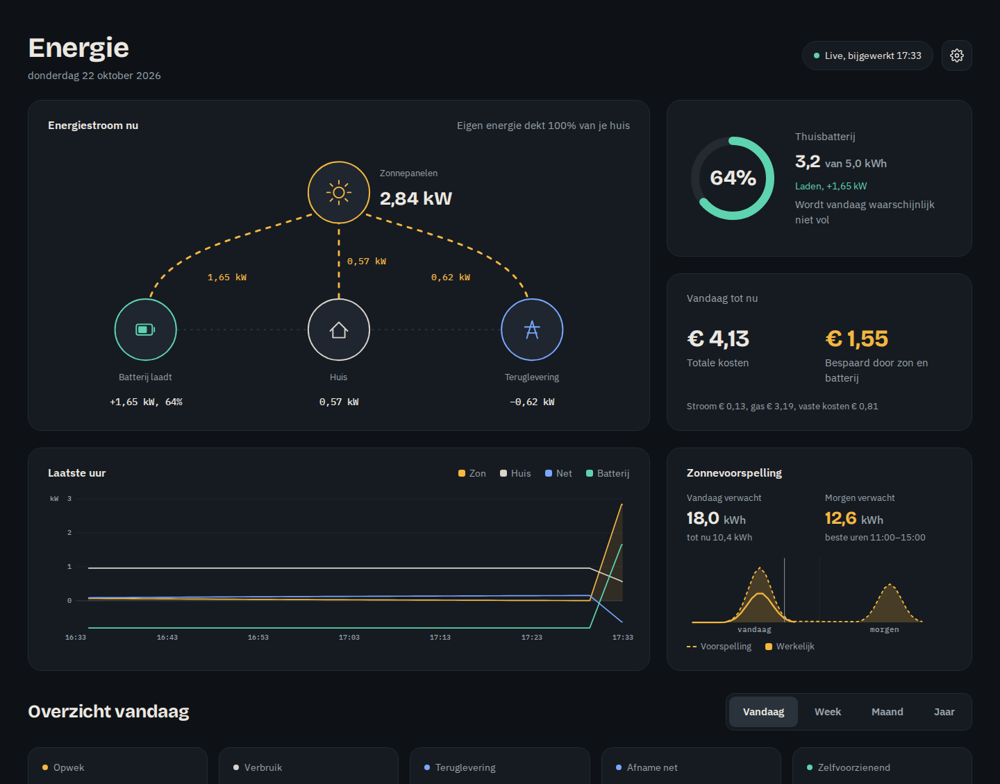
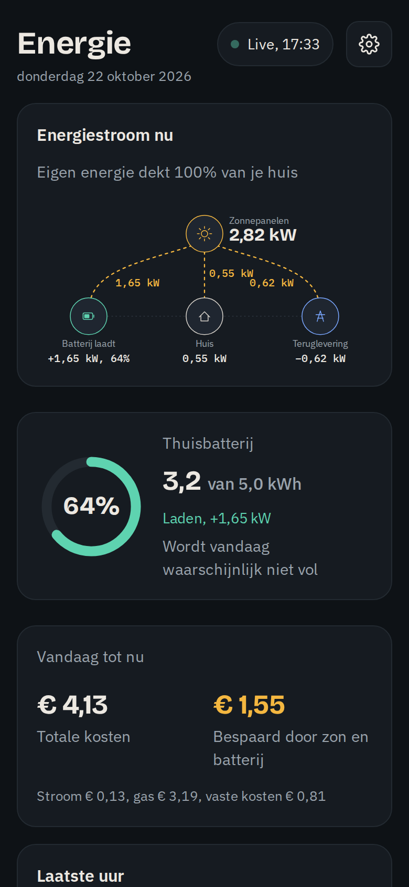
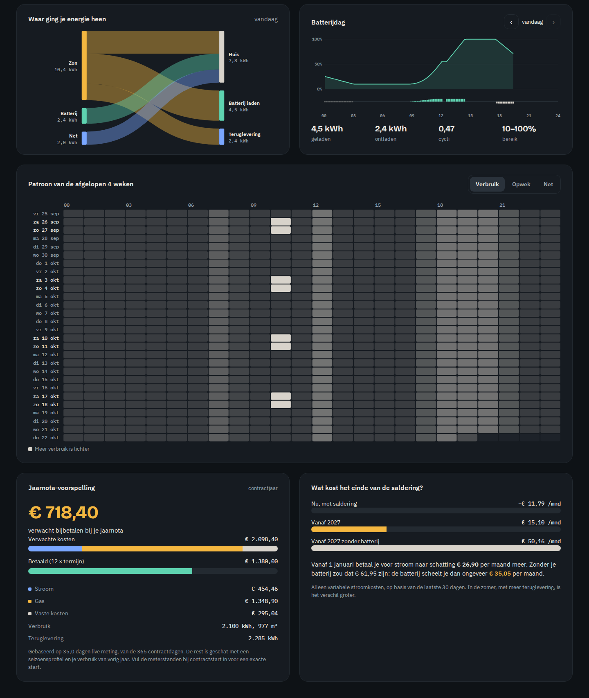
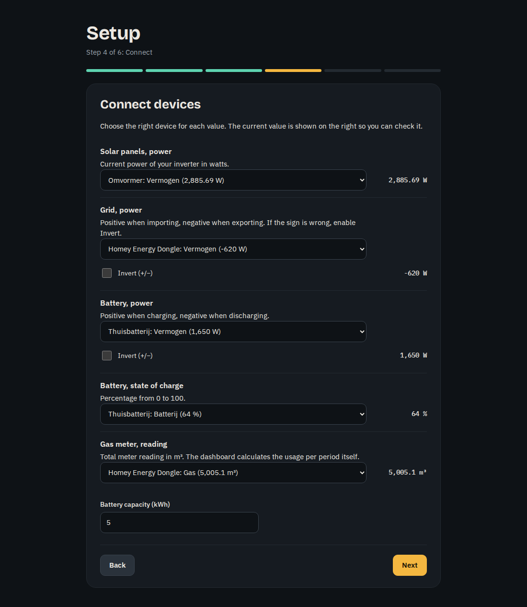

# Homey Energie Dashboard

Een lokaal, zelf te hosten energiedashboard voor **Homey Pro**. Zonnepanelen, thuisbatterij, net, gas en je energiecontract op één overzichtelijke pagina, met kosten die echt rekenen met jouw tarieven. Eén Docker-container, geen cloud, geen account, geen externe pakketten.

> 🇬🇧 **English documentation:** [README.en.md](README.en.md). Het dashboard zelf is beschikbaar in het Nederlands en het Engels.



<p align="center"></p>

## Functies

**Live**
- Bewegend schema van de energiestroom tussen zon, batterij, huis en net
- Batterij: laadtoestand, laden/ontladen en wanneer hij vol of leeg is (op basis van de zonnevoorspelling)
- Grafiek van het laatste uur, met waarden onder je muis of vinger
- Kosten en besparing van vandaag tot nu

**Terugkijken** (per dag, week, maand en jaar)
- Opwek, verbruik, teruglevering, afname en hoeveel procent je zelfvoorzienend bent
- Staafgrafiek opwek tegenover verbruik
- Sankey-diagram: waar ging je energie heen
- Batterijdag met laadverloop en cycli, met terugbladeren
- Heatmap van verbruik, opwek of net over de afgelopen 4 weken

**Kosten en contract**
- Normaal- en daltarief, inclusief weekenden en feestdagen
- Saldering tot 1 januari 2027, daarna automatisch terugleververgoeding en terugleverkosten
- Vaste leveringskosten, netbeheerkosten en vermindering energiebelasting, per dag meegeteld
- Contractlooptijd, termijnbedrag en aftelling naar het einde van de saldering

**Vooruitkijken**
- Zonnevoorspelling voor vandaag en morgen (via [forecast.solar](https://forecast.solar)), met de beste uren
- Jaarnota-voorspelling: bijbetalen of terugkrijgen?
- Wat kost het einde van de saldering jou, met en zonder batterij?

**Voor iedereen**
- Nederlands en Engels, automatisch in de taal van je browser of vast in te stellen
- Installatiewizard bij de eerste keer opstarten
- Nederland met alle Nederlandse regels, of een ander land met alleen je eigen tarieven (in je eigen valuta)
- Zonnepanelen, thuisbatterij, gas en Energy Dongle zijn allemaal optioneel

**Homey-koppeling**
- Het dashboard houdt Logica-variabelen bij in Homey voor je flows: overschot (W), zonne-overschot, batterij vol, batterij (%), daltarief, kosten vandaag en zon morgen



## Wat heb je nodig

- **Homey Pro** (2023 of nieuwer) met je apparaten erin: omvormer, slimme meter, eventueel thuisbatterij en gasmeter
- Een server, NAS of Raspberry Pi met **Docker**
- Optioneel maar aanbevolen: de **Homey Energy Dongle** met de Local API aan. Dan komen afname en teruglevering rechtstreeks uit de meterstanden van je slimme meter, en dat is het nauwkeurigst

Batterij en gas zijn optioneel: heb je ze niet, dan verbergt het dashboard die onderdelen.

## Installatie

```bash
mkdir homey-energie-dashboard && cd homey-energie-dashboard
curl -O https://raw.githubusercontent.com/rikadoo/homey-energie-dashboard/main/docker-compose.yml
mkdir data
# pas in docker-compose.yml het wachtwoord (SETTINGS_PASSWORD) aan
docker compose up -d
```

Open daarna `http://<server>:8080`. De eerste keer start de **installatiewizard**:

1. Taal en land kiezen
2. Homey koppelen (adres en API-sleutel)
3. Kiezen wat je hebt: zonnepanelen, thuisbatterij, gas, Energy Dongle
4. Apparaten koppelen (met een voorstel en de actuele waarde ter controle)
5. Tarieven invullen (mag ook later)
6. Extra's: zonnevoorspelling en signalen naar Homey



Alles is daarna aan te passen bij de instellingen (tandwiel rechtsboven). Daar kun je de wizard ook opnieuw starten.

De container zet de rechten op de map `data` zelf goed. Gebruik je Docker Desktop met WSL, zet de map dan in je Linux-thuismap (`~`) en niet op `/mnt/c`: op de Windows-schijf werken Linux-rechten niet goed.

Liever zelf bouwen? Clone de repository en vervang in `docker-compose.yml` de regel `image:` door `build: .`.

## Taal en land

- **Taal:** Nederlands of Engels. Standaard volgt het dashboard je browser; bij de instellingen kun je de taal vastzetten.
- **Land Nederland:** saldering tot 1 januari 2027 (met keuze voor de volgorde), terugleverkosten, de vermindering energiebelasting en Nederlandse feestdagen in het daltarief.
- **Ander land:** alleen je eigen tarieven: dag- en nachttarief, terugleververgoeding, eventueel terugleverkosten, gas en vaste kosten, in je eigen valuta. De Nederlandse onderdelen verdwijnen uit het dashboard en de instellingen.

## Instellen in detail

### 1. Homey Pro
Maak in de Homey-webapp (my.homey.app) onder **Instellingen → API-sleutels** een sleutel met deze rechten:

| Recht | Waarvoor |
|---|---|
| Apparaten weergeven (`homey.device.readonly`) | Meetwaarden uitlezen |
| Variabelen (`homey.logic`) | Alleen als je de signalen naar Homey wilt gebruiken |

Vul het lokale adres van je Homey in (bijv. `http://192.168.1.20`) en de sleutel, en klik **Apparaten ophalen**.

### 2. Homey Energy Dongle (optioneel)
Zet in de Homey-app bij de dongle onder **Geavanceerde instellingen** de **Local API** aan. Vul `ws://<IP-van-de-dongle>/ws` in en klik **Verbinding testen**. De dongle accepteert maximaal twee verbindingen tegelijk.

### 3. Meetwaarden
Kies per meetwaarde het apparaat in Homey (of de dongle) en klik **Testen**.

| Meetwaarde | Positief | Negatief |
|---|---|---|
| Net, vermogen | afname | teruglevering |
| Batterij, vermogen | laden | ontladen |

Klopt het teken niet, zet dan **Omkeren** aan. Met **Factor** reken je om (bijv. `1000` voor kW → W).

### 4. Contract
Neem de tarieven over van je contract, **inclusief energiebelasting en btw**, allemaal als positief getal. Kies ook hoe je leverancier saldeert: eerst met normaal (de meeste leveranciers) of per telwerk.

Optioneel, voor een betere jaarnota-voorspelling:
- **Meterstanden op de startdatum** van je contract (op te vragen bij je netbeheerder; laag/T1 = dal, hoog/T2 = normaal)
- **Jaarverbruik van vorig jaar** (van je vorige jaarnota), vooral belangrijk voor het gas als het dashboard nog geen winter heeft gemeten

### 5. Zonnevoorspelling (optioneel)
Vul locatie, vermogen (kWp), hellingshoek en richting in (0 = zuid, −90 = oost, 90 = west), voor maximaal twee dakvlakken.

### 6. Signalen naar Homey (optioneel)
Zet de signalen aan. De variabelen verschijnen in Homey onder **Logica**, allemaal beginnend met "Energie". Voorbeeld: *Als* "Energie zonne-overschot" aan wordt, *dan* de vaatwasser starten.

## Achter een reverse proxy

Het dashboard luistert op poort 8080. Voorbeeld voor **Traefik** met de file provider:

```yaml
http:
  routers:
    energie:
      rule: "Host(`energie.example.nl`)"
      service: energie
      entrypoints: [websecure]
      tls: {}
  services:
    energie:
      loadBalancer:
        servers:
          - url: "http://energie-dashboard:8080"   # container in hetzelfde Docker-netwerk als Traefik
```

Tip: laat Traefik de container via het Docker-netwerk bereiken (zoals hierboven) en niet via het IP van de server. Een firewall als `ufw` blokkeert anders vaak het verkeer van een container naar de eigen server.

## Updaten en back-up

```bash
docker compose pull && docker compose up -d
```

Alles wat je moet bewaren staat in de map `data`:
- `config.json`: je instellingen, inclusief de Homey-API-sleutel
- `energie.db`: alle metingen (SQLite)

## Hoe er gerekend wordt

- Elke 10 seconden (instelbaar) wordt gemeten; per minuut wordt een gemiddelde opgeslagen. Een minuut zonder metingen telt nergens mee: er wordt nooit over een gat heen gerekend.
- **Afname en teruglevering** komen bij voorkeur uit de meterstanden van de slimme meter, met normaal en dal zoals de meter ze telt. Zonder Energy Dongle wordt het gemeten vermogen gebruikt, met de daltijden uit je contract.
- **Huisverbruik** = zon + afname − teruglevering − batterij (laden) + batterij (ontladen).
- **Batterijwaarden die natuurkundig niet kunnen** (bijv. door vertraging van een cloud-koppeling) worden gecorrigeerd: laden met meer vermogen dan er van zon en net binnenkomt, en (bij een batterij met nul-op-de-meter-regeling) ontladen naar het net. Die laatste controle zet je uit bij de batterij-instellingen als jouw batterij wél terug mag leveren.
- **Saldering**: tot de wisseldatum is teruggeleverde stroom het leveringstarief waard; daarna geldt de terugleververgoeding. Terugleverkosten gelden per teruggeleverde kWh.
- **Vaste kosten** worden per dag meegeteld vanaf de eerste meting.
- **Jaarnota-voorspelling**: gemeten verbruik (live en uit meterstanden), aangevuld met een seizoensprofiel en eventueel je verbruik van vorig jaar.

## Privacy en veiligheid

- Alle gegevens blijven op je eigen server. De enige verbinding naar buiten is forecast.solar (alleen als je de zonnevoorspelling aanzet; die krijgt je locatie en paneelgegevens).
- Lettertypen worden meegeleverd, er gaan geen verzoeken naar Google.
- Zet altijd een `SETTINGS_PASSWORD`: de instellingenpagina bevat je Homey-sleutel. Zet het dashboard niet zonder extra beveiliging open naar internet.

## Beperkingen

- De Energy Dongle werkt met DSMR-slimme meters (Nederland en België). In andere landen komt het netvermogen via een ander Homey-apparaat; dan worden afname en teruglevering uit het vermogen berekend.
- Buiten Nederland is het kostenmodel eenvoudig: dag/nacht, terugleververgoeding en vaste kosten. Speciale regelingen van andere landen (zoals een capaciteitstarief) zitten er niet in.
- Thuisbatterijen die via een cloud-koppeling in Homey zitten, kunnen achterlopen. Het dashboard vangt onmogelijke waarden af, maar een verouderde waarde die wél kan kloppen is niet te herkennen.
- De kostenberekening is een benadering en geen vervanging van je jaarnota.

## Ontwikkelen

Geen afhankelijkheden: Node.js 22.13 of nieuwer is genoeg (gebruikt de ingebouwde `node:sqlite`, `fetch` en `WebSocket`).

```bash
DATA_DIR=./data SETTINGS_PASSWORD=test npm start
```

```
server.js          webserver en API
lib/collector.js   meten, correcties, opslaan per minuut
lib/sources.js     Homey, Energy Dongle en HTTP-bronnen
lib/dsmr.js        P1-telegrammen ontleden
lib/stats.js       overzichten, kosten, daltijden, feestdagen
lib/insights.js    Sankey, heatmap, batterijdag, jaarnota, saldering
lib/solar.js       zonnevoorspelling
lib/signals.js     variabelen in Homey
lib/i18n.js        vertaling van servermeldingen
public/            dashboard, instellingen en wizard (HTML, CSS, JS, SVG-grafieken)
public/i18n.js     vertaallaag; public/lang-en.js bevat de Engelse teksten
```

### Vertalen
De Nederlandse tekst is de sleutel. Een nieuwe tekst gebruik je in de code als `t('Nederlandse tekst')` en voeg je toe aan `public/lang-en.js`. Ontbreekt een vertaling, dan blijft de Nederlandse tekst staan. Wil je een taal toevoegen? Maak een `lang-xx.js` en breid `public/i18n.js` uit; pull requests zijn welkom.

## Licentie

MIT, zie [LICENSE](LICENSE). Lettertypen: Bricolage Grotesque en IBM Plex, onder de SIL Open Font License 1.1 (zie `public/fonts/LICENSE-fonts.txt`).

Dit project is niet verbonden aan Athom (Homey) of aan een energieleverancier. De screenshots tonen demogegevens.
